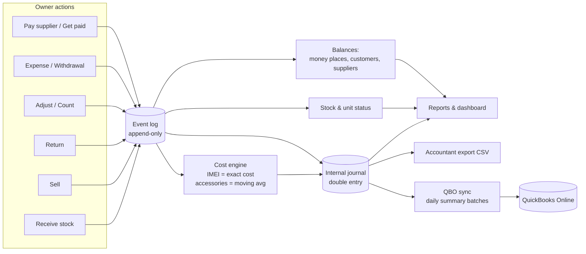
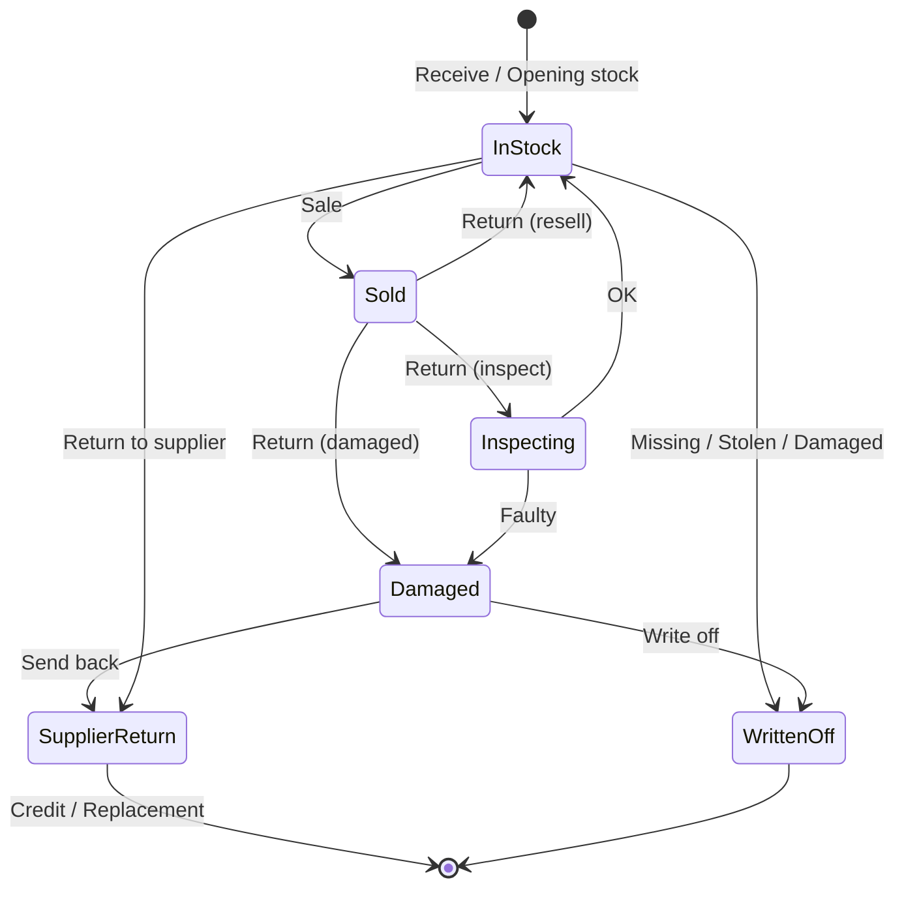
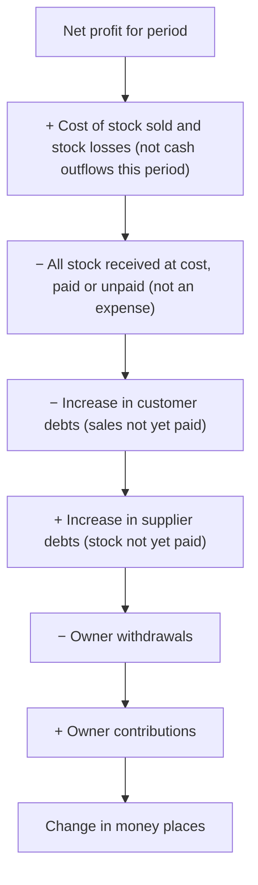
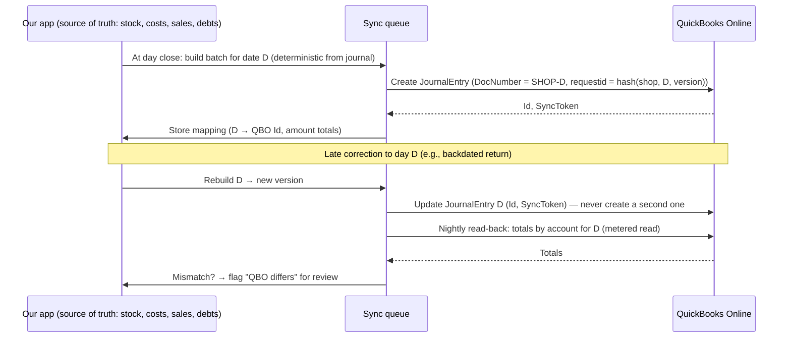

# 06 — Inventory & Accounting Data Flows

These are design proposals [I]. The diagrams use Mermaid, which renders on GitHub and in most Markdown viewers.

## 1. Core principle: one event, many projections

The owner performs **business events**. Each event is stored once, permanently. Everything else is **derived** from events:
- stock levels;
- unit status;
- balances;
- the accounting journal;
- QuickBooks sync batches.

Derived data can be rebuilt from the events. Because it is never typed twice, it cannot drift.

## 2. Stock flow (units and quantities)

## 3. Event → journal mapping (what happens in the background)

"Dr" (debit) means the bucket on the left side grows (an asset or cost). "Cr" (credit) means the source. The owner never sees these terms.

| Event | Debit | Credit |
|---|---|---|
| Opening stock | Inventory | Opening balance equity |
| Receive, paid now | Inventory | Money place |
| Receive, pay later | Inventory | Accounts payable (supplier) |
| Pay supplier | Accounts payable | Money place |
| Sale (each payment part) | Money place | Sales |
| Sale (unpaid part) | Accounts receivable (customer) | Sales |
| Sale cost | COGS | Inventory |
| Customer pays debt | Money place | Accounts receivable |
| Return with refund | Sales returns *(or Sales)* | Money place |
| Return cost back to stock | Inventory | COGS |
| Return to Damaged status | Stock loss | COGS |
| Write-off | Stock loss | Inventory |
| Count gain | Inventory | Stock loss |
| Expense paid | Expense category | Money place |
| Expense unpaid | Expense category | Accounts payable (other) |
| Owner withdrawal | Owner drawings | Money place |
| Owner contribution | Money place | Owner capital |
| Move money (with fee) | Destination + Bank fees | Source |
| Cash over/short | Cash over/short | Cash drawer (or reversed) |
| Tax on sale (if applicable) [U] | — | Tax payable (split from Sales) |

**Invariant [I]:** for any period, the sum of debits equals the sum of credits. Inventory account balance = Σ(cost of units in stock) + Σ(qty × avg cost for accessories). This is checked automatically every night (see the reconciliation section below).

## 4. Cash versus profit bridge

(Rendered in the app as a short, plain-language list. The order shown is illustrative.)

## 5. QuickBooks sync flow (recommended design; see [07](07-quickbooks-feasibility.md))

## 6. Reconciliation loops (automatic, nightly) [I]

| Check | Compares | On mismatch |
|---|---|---|
| Journal balance | Σ debits vs Σ credits | Block reports, raise an engineering alert |
| Stock value | Inventory account vs unit/qty × cost projection | Flag |
| Money places | Expected drawer vs counted at close | Cash over/short entry |
| Customers / suppliers | Ledger total vs A/R / A/P account | Flag |
| QBO | Our day totals per account vs QBO journal for that day | "Needs review" item; do **not** auto-fix QBO-side edits |
| Physical stock | Count events | Write-off / gain with reason |
