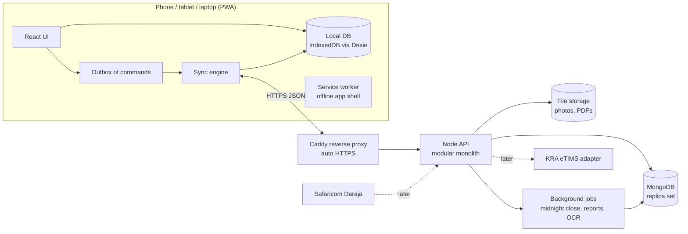
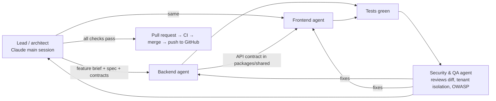

# ARCH-01 — Architecture & Engineering Plan

Status: **APPROVED by founders** · 2026-10-31 (login changed by founders, see §8)
Inputs: feature specs F01–F12 and the global rules in [../features/](../features/).

## 1. Decisions already made by the founders

| Topic | Decision |
|---|---|
| Frontend | **React SPA**, running as an installable **PWA** (one app for Android, iPhone, tablet, laptop, desktop) |
| Backend | **Node.js** |
| Database | **MongoDB** |
| Hosting | **The founders' own VPS** |
| Builders | **Claude**, as a coordinated team of agents (lead + backend + frontend + security), pushing each feature to GitHub after it passes tests |
| Budget | No paid services for the MVP (no SMS provider) |
| Priority | Ship fast, but **scalable, modular, readable** code (no 500-line files) |

## 2. MVP or "the best"? Recommendation

**Build MVP *features* on production-grade *foundations*.**

| Get right now (expensive to change later) | Defer (cheap to add later) |
|---|---|
| Module boundaries and folder structure | Microservices, Kubernetes |
| Data model, multi-tenancy (one database, `tenantId` everywhere) | Read replicas, sharding, caching layers |
| The offline **sync protocol** and idempotency | Real-time push (WebSockets); polling is fine at first |
| Money handling and the **ledger** (double entry, integer cents) | Advanced analytics pipeline |
| Auth, roles, device trust, audit log | SMS/WhatsApp OTP, SSO |
| Automated tests and CI from the first commit | Load testing at scale |
| Clean deploy, backups and HTTPS on the VPS | Multi-region hosting |

**Architecture style: a *modular monolith*.**
- One Node application split into strict modules (catalog, inventory, sales, …), each owning its own data and exposing a small service interface.
- One deployment, simple operations on one VPS.
- It can scale horizontally (several API processes behind the proxy), and any module can later be split into its own service *if needed*.
- **Not microservices now:** for a small team, they multiply ops work and failure points with no benefit at this size.

## 3. System overview



## 4. Technology choices (within React + Node + MongoDB)

| Area | Choice | Why |
|---|---|---|
| Language | **TypeScript everywhere** | Catches mistakes early; shared types between frontend and backend; agents produce more consistent code |
| Repo | **Monorepo (pnpm workspaces)**: `apps/web`, `apps/api`, `packages/shared` | One place for shared rules (money, IMEI check, validation schemas) used by both sides |
| Web build | React + **Vite** + **vite-plugin-pwa** (Workbox) | Fast build, installable offline app |
| Web state | **TanStack Query** (server data), **Zustand** (UI state), **Dexie** (IndexedDB local DB) | Small, well-known, works offline |
| UI kit | **Tailwind + shadcn/ui** (accessible components we own) | Responsive phone → desktop; no heavy theme lock-in |
| Translations | **i18next** (English, Somali) | Standard; every string from day one |
| Scanning | **ZXing (JS)** via the camera; USB/Bluetooth scanners act as keyboards | Works in all browsers, including iPhone |
| API framework | **NestJS** (on the Fastify adapter) | Enforces modules, dependency injection and testing patterns, so every agent writes code the same way. Fastify underneath for speed |
| Validation | **Zod** schemas in `packages/shared` | Same rules on device and server |
| MongoDB access | **Mongoose** models inside each module's repository layer only | Schemas plus indexes; nothing outside a repository touches the database |
| Jobs | **BullMQ + Redis** (on the same VPS) | Reliable scheduled jobs (midnight close, PDFs, OCR) |
| PDFs | **pdfmake**, with templates in `packages/documents` used by both device and server | Day summaries work offline (F11); purchase orders and receipts look the same everywhere |
| OCR (F05) | Server-side **PaddleOCR or Tesseract** on the VPS (free); **Tesseract.js** on the device when offline | Google ML Kit is **not available in a browser app** (see §9) |
| Tests | **Vitest** (unit), **Supertest + mongodb-memory-server (replica set)** (API), **Playwright** (end-to-end) | Fast, standard |
| Quality | ESLint, Prettier, TypeScript strict, Husky pre-commit, **GitHub Actions CI** | Nothing merges without passing lint, types and tests |
| Deploy | **Docker Compose**: Caddy, api, worker, MongoDB (single-node replica set), Redis | Simple on one VPS; the same files grow to more servers |

## 5. Modules (bounded contexts)

Each module = its own folder, its own collections, a public service interface, and its own tests. **Modules never read another module's collections directly.**

| Module | Owns | Features |
|---|---|---|
| `identity` | businesses (tenants), users, roles, devices, sessions | F02 |
| `locations` | locations, money places, business details | F02, F11 |
| `catalog` | products, categories, brands, barcodes, prices | F01 |
| `parties` | suppliers, customers, neighbours (contacts), payment rules | F03, F06 |
| `inventory` | stock movements, units (IMEIs), stock levels, counts, transfers | F04, F08, F10 |
| `purchasing` | deliveries, orders, claims, supplier returns, invoice scans | F04, F05, F08 |
| `sales` | sales, carts, parked sales, reservations, quotations, returns | F06, F08, F09 |
| `payments` | payments, allocations, advances, credits, write-offs, offsets | F07 |
| `ledger` | double-entry journal generated from events (internal) | all |
| `cash` | expenses, owner money, money moves, day close | F11 |
| `reporting` | dashboard figures, daily aggregates, exports | F12 |
| `documents` | receipts, POs, statements, PDFs | many |
| `sync` | command intake, change feed, conflicts | G6 |
| `audit` | who-did-what log | G4 |
| `etims` *(later)* | KRA integration | F13 |

## 6. Code structure and rules ("not 500 lines in one file")

```
apps/api/src/modules/sales/
  sales.module.ts            # wiring only
  api/                       # HTTP controllers + request/response DTOs (thin)
  application/               # use cases: create-sale.ts, park-sale.ts, ... (one per file)
  domain/                    # pure business rules: pricing, profit, credit-limit (no I/O)
  infrastructure/            # repositories, Mongoose schemas, mappers
  events/                    # events this module publishes / listens to
  __tests__/
apps/web/src/features/sales/
  pages/  components/  hooks/  api/  store/  i18n/  __tests__/
packages/shared/src/
  money/  imei/  validation/  types/  permissions/
```

**House rules** (written into `CLAUDE.md` in the repo so every agent follows them):
1. **One responsibility per file. Target < 200 lines, hard limit 300** (enforced by a lint rule).
2. **Layering:** controller → use case → domain → repository. Controllers have no business logic; domain code has no database or HTTP.
3. **Money = integer cents** (shared `Money` type). Never floats.
4. **Every database query is scoped by `tenantId`.** The repository base class enforces it, and tests check that one business can never see another's data.
5. **Every write is idempotent:** commands carry a client-generated `commandId`.
6. **Nothing is deleted** (G4): status changes and reversing entries only.
7. Every user-facing string goes through i18n; no hard-coded text.
8. Each feature ships with **tests mapped to the spec's T-cases**.

## 7. Offline and sync design (the hardest part)

MongoDB's own device-sync product (Atlas Device Sync / Realm) was **deprecated in September 2024 and removed on 30 September 2025** [V-s: MongoDB docs]. So we build a small, well-defined sync ourselves. This fits our event model.

1. **Device writes locally first:** the action is applied to the local database (Dexie), and a **command** (e.g. `CreateSale{commandId, payload, deviceId, userId, localTime}`) goes to the **outbox**.
2. **Push:** when online, the sync engine sends outbox commands in order. The server validates each one, applies it in a **MongoDB transaction** (which needs a replica set, even with one node), writes events and ledger entries, and returns the result. A command already seen (same `commandId`) returns the original result, so there are no duplicates.
3. **Pull:** the device asks "changes since cursor N" for its business and allowed locations. The server returns changed records in order of a server sequence number.
4. **Conflicts** (the same IMEI sold twice, the same M-Pesa code, an overpayment, a duplicate product) are **never silently fixed**. The server accepts the facts, records a **conflict** item, and the owner resolves it (G6). This matches the specs.
5. **Server time** decides day boundaries. Device time is stored for reference. Offline devices must sync every 24 h (F02).
6. **Device data scope:** each device stores only its business, its locations and recent history, which keeps phones light.

## 8. Login and security (founders' decision: phone number or email + strong password, multi-tenant)

**Everyone (owners and staff) logs in with a phone number *or* email, plus a strong password.** No SMS needed.
- **Strong password rule:** at least 10 characters, with at least 3 of these 4 kinds: lower case, upper case, digits, symbols. Common or leaked-looking passwords (a block list) are refused. The same rule runs on the device and on the server.
- **Phone numbers** are stored in one standard format (e.g. `0712 345 678` → `+254712345678`), so the same person can't register twice with different spellings.
- **Multi-tenant:**
  - one database; every record carries `tenantId` (the business);
  - **one person can belong to several businesses** (a membership per business, each with its own role and locations);
  - after login, a person in more than one business picks which one;
  - tests prove one business can never read another's data.
- **Owner sign-up:** business name + owner name + phone and/or email + password. Recovery: 10 one-time **recovery codes** shown once, email reset (when an email is given), or another owner resets it.
- **Staff:** the owner creates the staff member with their phone or email and a **temporary password**. The staff member **must change it** at first login.
- **Shared shop devices / quick switching:** after a full login on a registered device, a **quick-unlock PIN** may be used to switch users (decided in the F02 build).
- **Under the hood:**
  - argon2id password hashing;
  - short-lived access token (15 min) plus a rotating refresh token in secure httpOnly cookies (detects stolen refresh tokens);
  - login rate limits and lockout after repeated failures;
  - an audit log of every login;
  - device approval for "only approved devices" locations (F02).
- SMS or WhatsApp codes can be added later as a second factor.

**Security baseline** (enforced by the security agent on every feature):
- OWASP ASVS-level checks; input validation (Zod); tenant-isolation tests; Helmet/CSP; strict CORS; rate limits.
- The database is not exposed to the internet; least-privilege DB user.
- Secrets in environment files, not in Git; dependency scanning (Dependabot / `npm audit`).
- HTTPS everywhere (Caddy); **encrypted nightly backups copied off the VPS**.

## 9. Platform limits of a web app (PWA) and how we handle them

| Need (from specs) | Android / desktop Chrome | iPhone / iPad (Safari) | Plan |
|---|---|---|---|
| Offline data | ✔ | ✔ **only if installed to the Home Screen.** Safari can wipe data of non-installed sites after 7 days without use [V-s: WebKit] | The app requires **"Add to Home Screen"** on iPhone (guided step) and requests persistent storage |
| Camera barcode/IMEI scan | ✔ | ✔ (camera via browser) | ZXing |
| **Bluetooth receipt printer** (F01, F06) | ✔ (Web Bluetooth) | ✖ **Not supported in any Safari version** [S] | iPhone: print via the share sheet/AirPrint (PDF), or WhatsApp/SMS receipts. **Later option:** wrap the same React app with **Capacitor** to get native Bluetooth and ML Kit, with no rewrite |
| On-device invoice reading (F05) | Tesseract.js (weaker than ML Kit) | Tesseract.js | **Spec impact:** F05 layer 2 becomes "OCR on our own VPS (free), Tesseract.js when offline". Same free goal, different tool |
| WhatsApp share with PDF | ✔ (Web Share with files) | ✔ | As in F04/F12 |

## 10. Spec changes caused by these decisions (founders to confirm)
1. **F02 login:** "SMS code and invite" is replaced by **phone/email + strong password for everyone** (§8). *(Approved.)*
2. **F05 OCR:** ML Kit is replaced by **server OCR on the VPS + Tesseract.js offline** (§9).
3. **Printing on iPhone:** via PDF/AirPrint/share, not Bluetooth, unless we later wrap with Capacitor.
4. **iPhone users must install the app to the Home Screen** to keep offline data safe.

## 11. How the agent team works (per feature)



- **One branch per feature** (`feature/F01-products`). Agents work in isolated worktrees, so they don't overwrite each other.
- **Contracts first:** the lead writes shared types and API contracts in `packages/shared` before backend and frontend start, so they build against the same shapes.
- **Definition of done:** all spec T-cases pass as automated tests; lint, types and CI pass; the security review has no open high issues; the feature is demo-able; the docs are updated. **Only then** is it merged and pushed.
- **You approve each feature** after a short demo or summary, the same as the specs.

## 12. Build order

| Slice | Content |
|---|---|
| **S0 Foundation** | Monorepo, CI, Docker/VPS deploy, auth + devices (F02 login), tenancy, sync engine skeleton, ledger skeleton, i18n, design system, audit log |
| S1 | F02 Locations and staff (rest) + F01 Products |
| S2 | F03 Suppliers + F04 Receiving / starting stock / orders |
| S3 | F06 Selling (+ customers) |
| S4 | F07 Payments + F11 Day close and expenses |
| S5 | F08 Returns/counts + F10 Transfers + F09 Neighbours |
| S6 | F05 Invoice photo + F12 Dashboard/reports |
| S7 | F13 eTIMS (after certification) → pilot hardening |

**A pilot can start after S4.** That is the minimum loop: products → stock in → sell → payments → day close.

## 13. Scalability path (when needed, in order)
1. More API processes (PM2/Docker replicas) behind Caddy; the API is stateless.
2. A bigger VPS; MongoDB indexes tuned per real queries; pre-computed daily report aggregates (already planned).
3. Separate server for MongoDB (3-node replica set for safety); Redis on its own server.
4. Move heavy jobs (OCR, PDFs, exports) to separate worker servers.
5. Only if a module truly needs it: split it out as a service. The module boundaries make this possible.

## 14. Decisions for the founders
1. Approve **modular monolith + production-grade foundations** (§2).
2. Approve the **tool choices** in §4, especially **TypeScript**, **NestJS** and the **monorepo**.
3. Approve the **login design** without SMS (§8) and the other **spec changes** in §10.
4. VPS: **4 CPU / 6 GB RAM, already running other software**. Subdomain **books.solforbs.com**. Our containers must not clash with existing ports. They bind to localhost, and the VPS's existing web server forwards `books.solforbs.com` to them (exact setup at deploy time).
5. GitHub repo: **https://github.com/solforbs/books** (branch `main`).
